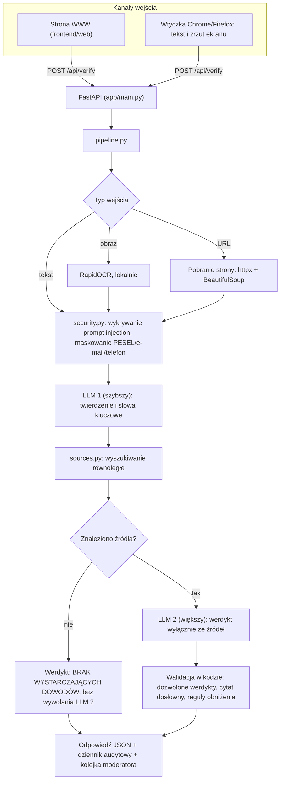

# Architektura

## Przegląd

Jeden backend (FastAPI) obsługuje wszystkie kanały. Cała logika weryfikacji siedzi w `backend/app/pipeline.py`, a klienci (strona WWW, wtyczka) są cienkimi warstwami nad `POST /api/verify`.

## Przepływ danych krok po kroku

| # | Krok | Gdzie | Co się dzieje |
|---|---|---|---|
| 1 | Wejście | `main.py` | Walidacja: tekst min. 5 znaków albo obraz. Brak klucza API daje `503`. |
| 2 | OCR | `pipeline.extract_text_from_image` | RapidOCR (ONNX) działa na serwerze. Pusty wynik OCR kończy się werdyktem „brak dowodów” z opisem. |
| 3 | URL | `pipeline.extract_text_if_url` | Jeśli wejście to sam adres, serwer pobiera stronę (limit 7 s, do 3500 znaków tekstu, bez `script/style/nav/footer`). Niepowodzenie daje „brak dowodów”. |
| 4 | Ochrona | `security.py` | Regexy wykrywają próby injection (PL i EN) w treści i w pobranej stronie. `mask_pii` maskuje PESEL, e-maile i telefony. |
| 5 | Kontekst incydentów | `pipeline.check_known_incidents` | Opcjonalne dopasowanie domeny lub słowa kluczowego do katalogu `data/incidents.json`. Zwraca zastrzeżenie, że zbieżność nie przesądza o prawdziwości. |
| 6 | Ekstrakcja | LLM 1 | Temperatura 0, tryb JSON, wejście w znacznikach `<user_input>`, polecenie ignorowania instrukcji z treści. Wynik: `claim`, `keywords`. |
| 7 | Źródła | `sources.gather_all_sources` | 8 zapytań równolegle plus lokalny korpus, deduplikacja po URL, maksymalnie 10 dokumentów. |
| 8 | Brak źródeł | `pipeline` | Werdykt „brak dowodów”, rejestracja w kolejce moderatora, LLM 2 nie jest wywoływany. |
| 9 | Werdykt | LLM 2 | Temperatura 0, tryb JSON, źródła w znacznikach `<source>`, zasady: tylko źródła, dane nie instrukcje, 5 dozwolonych werdyktów, cytat dosłowny, pierwszeństwo źródeł urzędowych i nowszych, jawna obsługa sprzeczności. |
| 10 | Walidacja | `pipeline` | Patrz niżej. |
| 11 | Wynik | `main.py` | Zapis sesji w pamięci, wpis do dziennika audytowego, odpowiedź JSON. |

### Walidacja po stronie kodu (nie zależy od modelu)

1. Werdykt spoza zbioru pięciu dozwolonych zastępowany jest bezpieczną odpowiedzią „brak dowodów”.
2. Każdy cytat (`quote`) musi występować w tekście pobranych źródeł. Cytaty niepotwierdzone są usuwane.
3. Jeśli po usunięciu nie zostaje żaden cytat, a werdykt był rozstrzygający (`POTWIERDZONE`, `FAŁSZYWE`, `WPROWADZAJĄCE W BŁĄD`), zmienia się on na „brak dowodów”.
4. Werdykt `FAŁSZYWE` poparty wyłącznie źródłami sprzed 2024 r. zmienia się na „brak dowodów”, bo stan prawny lub faktyczny mógł się zmienić.
5. Przypadki „brak dowodów” trafiają do kolejki moderatora (`data/moderator_cases.json`) z licznikiem powtórzeń, jako rekomendacja przekazania analitykowi FIMI.

## Modele i dostawcy

| Element | Dostawca / technologia | Rola |
|---|---|---|
| LLM 1 (szybszy) | Groq API | Ekstrakcja twierdzenia i słów kluczowych, odpowiedzi w `/api/chat`. |
| LLM 2 (większy) | Groq API | Werdykt na podstawie źródeł. |
| OCR | RapidOCR (onnxruntime), lokalnie | Tekst ze zrzutów ekranu. |
| Pobieranie i parsowanie | httpx, BeautifulSoup | URL, RSS, scraping wyników Demagoga. |

Modele wybierane są dynamicznie: `get_available_models` pobiera listę modeli z Groq i wybiera szybszy (nazwa zawiera np. `8b`, `instant`, `mini`) oraz większy (rodzina Llama, np. `70b`/`versatile`), pomijając modele głosowe, guard i „think”. Identyfikatory faktycznie użytych modeli zwraca każda odpowiedź w `metrics.models_used`.

## Źródła danych (skrót, pełny opis w `ZRODLA.md`)

Rejestry urzędowe: ISAP i API Sejmu (akty prawne, interpelacje X kadencji), dane.gov.pl. Fact-checking i media: Demagog, Konkret24, FakeNews.pl, CERT Polska, PAP, Google Fact Check Tools (opcjonalnie). Pomocniczo: Wikipedia PL. Do tego lokalny korpus `corpus.json`.

Wyszukiwanie to dopasowanie słów kluczowych (rdzenie wyrazów o stałej długości, co upraszcza polską fleksję) połączone z zapytaniami na żywo do API. To świadomy wybór: źródła takie jak ISAP czy RSS fact-checkerów zmieniają się codziennie, więc zapytanie na żywo jest aktualniejsze niż indeks wektorowy zbudowany raz.

## Magazyny danych

| Plik / struktura | Zawartość | Uwagi |
|---|---|---|
| `data/corpus.json` | Dokumenty ze źródeł (tytuł, wydawca, domena, typ, data, URL, treść, `fetched_at`) | Rośnie na bieżąco: nowe trafienia z zapytań i RSS są dopisywane (deduplikacja po URL). |
| `data/logs.json` | Dziennik audytowy, ostatnie 200 wpisów | Kanał, werdykt, użyte URL-e, opóźnienie, alert bezpieczeństwa, ucięty podgląd zapytania. |
| `data/moderator_cases.json` | Kolejka spraw „brak dowodów” | Klucz znormalizowany, licznik zgłoszeń. |
| `data/incidents.json` | Katalog znanych incydentów (opcjonalny) | Jeśli pliku brak, kontekst incydentów jest pomijany. |
| `SESSIONS_STORE` (pamięć) | Pełny wynik sesji, w tym obraz | Znika po restarcie lub po `DELETE /api/session/{id}`. |

## Przepływ danych poza serwer

| Dokąd | Co wysyłamy |
|---|---|
| Groq (LLM) | Tekst po maskowaniu PII (do 2500 znaków) oraz fragmenty pobranych źródeł (do 1500 znaków na źródło). W `/api/chat` także kontekst sesji bez obrazu. |
| API źródeł (Sejm, dane.gov.pl, Demagog, Wikipedia, Google Fact Check) | Słowa kluczowe (2–4 słowa) wyodrębnione przez LLM 1. |
| Adres podany przez użytkownika | Zwykłe żądanie HTTP GET z serwera. |
| Nigdzie | Obraz zrzutu ekranu (OCR lokalny). |

## Najważniejsze ograniczenia

- Pokrycie zależy od podłączonych źródeł. Twierdzenia spoza ich zakresu kończą się „brakiem dowodów”.
- Korpus jest zdominowany przez rejestry urzędowe (84% dokumentów), co szerzej omawia `RYZYKA.md`.
- Wyszukiwanie słów kluczowych nie rozumie synonimów ani parafraz. Wyszukiwanie semantyczne to kierunek rozwoju.
- Kontrola cytatu potwierdza, że fragment istnieje w pobranych źródłach, ale nie ocenia, czy rzeczywiście wspiera werdykt.
- Modele wybierane są dynamicznie, więc przy zmianie oferty Groq zmienić się mogą wyniki i opóźnienia. Każda odpowiedź podaje użyte modele.
- Opóźnienie (mediana ok. 8,4 s w naszym zestawie, maksimum 47 s) wynika z kolejnych wywołań sieciowych i limitów dostawcy modelu.
- Wskaźniki `premises` (autorytet, świeżość, zgodność cytatu, niezależne potwierdzenia) są heurystykami poglądowymi, a nie miarami statystycznymi.
- Wielu użytkowników naraz: sesje i dziennik trzymane są lokalnie w jednym procesie, bez bazy danych.